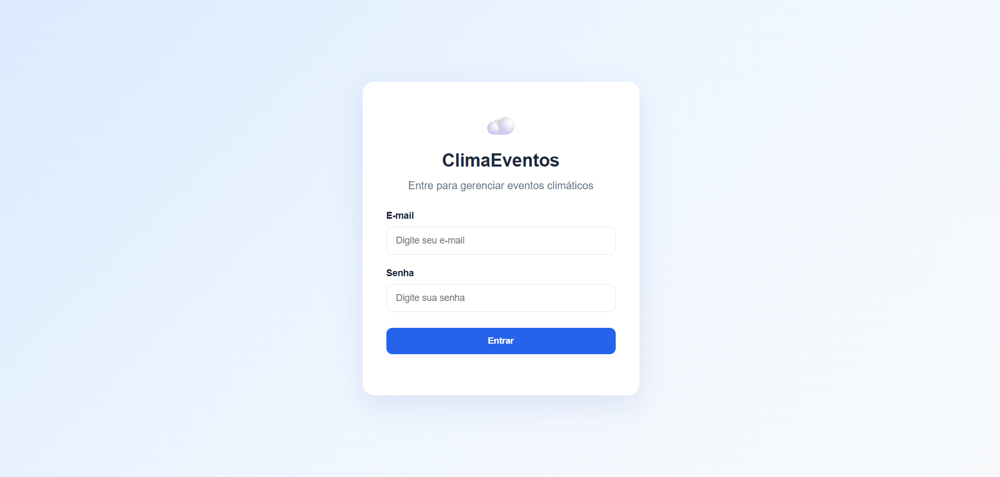
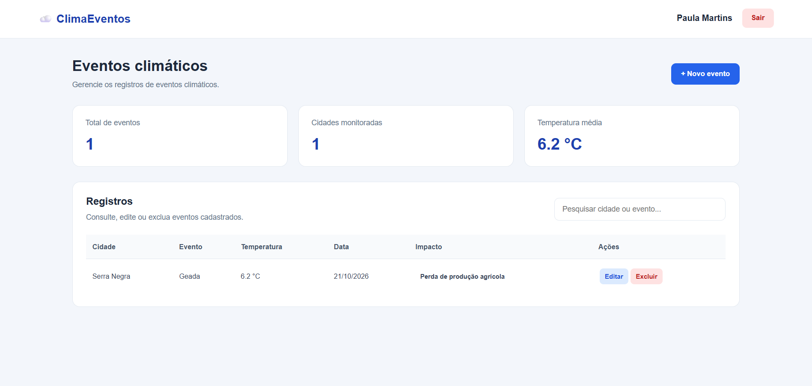

# Eventos Climáticos

Sistema full stack para cadastro e gerenciamento de eventos climáticos, permitindo que usuários façam login e registrem informações como cidade, tipo de evento, temperatura e nível de impacto.

## Tecnologias

- HTML
- CSS
- JavaScript
- Node.js
- Express
- Prisma
- MySQL

## Como executar

1. Clone este repositório.
2. Instale as dependências com `npm install`.
3. Configure as variáveis de ambiente no arquivo `.env`.
4. Inicie o projeto com `npm run dev`.

## Funcionalidades

- Login de usuários cadastrados.
- Cadastro, consulta, edição e exclusão de eventos climáticos.

## Screenshots

